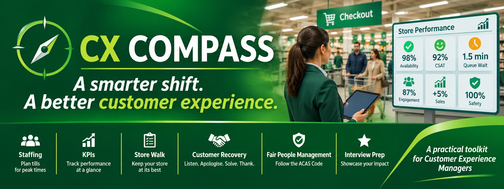

# CX Compass: Store Shift Toolkit for Customer Experience Managers

A free, single-file web app for store and customer experience managers in supermarkets and large retail (Sainsbury's, Aldi, Tesco, department stores and similar). No install, no server, no tracking. Open `index.html` in any browser.

## What it does

| Tab | Purpose |
|---|---|
| **Staffing** | Estimates staffed tills needed each hour from footfall, service time and self-checkout share |
| **KPIs** | Red/amber/green board for availability, customer satisfaction, queue wait, colleague engagement, sales and safety |
| **Store walk** | Checkout, petrol station, shop floor and back-of-house checklist with progress |
| **Recovery** | Builds a Listen, Apologise, Solve, Thank script for common customer complaints |
| **People** | Fair disciplinary, performance and absence path aligned to the ACAS Code, with a fairness check |
| **Interview prep** | STAR answer builder mapped to Customer Experience Manager requirements |
| **Colleague voice** | Engagement action board: scores vs company and last survey, strengths, opportunities and monthly actions |
| **Night & systems** | Night shift and tills/IT checks, with likely questions |
| **Huddle & handover** | Five-minute huddle script and a shift handover note builder |
| **Coaching** | GROW coaching plan builder and coaching questions |
| **Learn** | Video searches and official guidance links |

All figures and targets are **examples**: edit them to match your own store. Data stays in your browser (localStorage).

## Careers and job sites

- [Sainsbury's jobs](https://www.sainsburys.jobs/)
- [Aldi recruitment UK](https://www.aldirecruitment.co.uk/)
- [Tesla careers UK](https://www.tesla.com/en_gb/careers)
- [Indeed UK](https://uk.indeed.com/)
- [LinkedIn Jobs](https://www.linkedin.com/jobs/)

## Offline Excel

`CX_Compass_Offline.xlsx` works without internet: staffing calculator, KPI board with red/amber/green, store walk, handover log and coaching log. Yellow cells are inputs.

## Run it

1. Download or clone the repo (keep `banner.jpg` and the Excel file next to `index.html`).
2. Open `index.html`.

Host free with GitHub Pages: **Settings > Pages > Deploy from branch > main / root**.

## Disclaimer

Independent learning project. Not affiliated with or endorsed by any retailer. The People tab is general guidance, not legal advice: follow your employer's policy and involve HR.

## About the builder

VB (Venkateswararao Banday) is a multi-sector programme and operations leader with the right to work in the UK and India, looking for roles in London.

I build apps with AI and share them free to spread knowledge and useful information. If this helped you, and you know of any opportunity or can refer me, I would be very grateful.

[WhatsApp +91 9962507575](https://wa.me/919962507575) · [WhatsApp +44 7391 522993](https://wa.me/447391522993) · [LinkedIn](https://www.linkedin.com/in/venkateswararao-banday)

Enjoyed it? [Share on LinkedIn](https://www.linkedin.com/sharing/share-offsite/?url=https://github.com/venkatbanday/PM-Compass) · [Share on WhatsApp](https://wa.me/?text=Free%20store%20shift%20toolkit%20for%20retail%20managers%3A%20https%3A%2F%2Fgithub.com%2Fvenkatbanday%2FPM-Compass) · [⭐ Star on GitHub](https://github.com/venkatbanday/PM-Compass)

Prefer not to click links? WhatsApp +91 9962507575 · WhatsApp +44 7391 522993 · LinkedIn: linkedin.com/in/venkateswararao-banday
